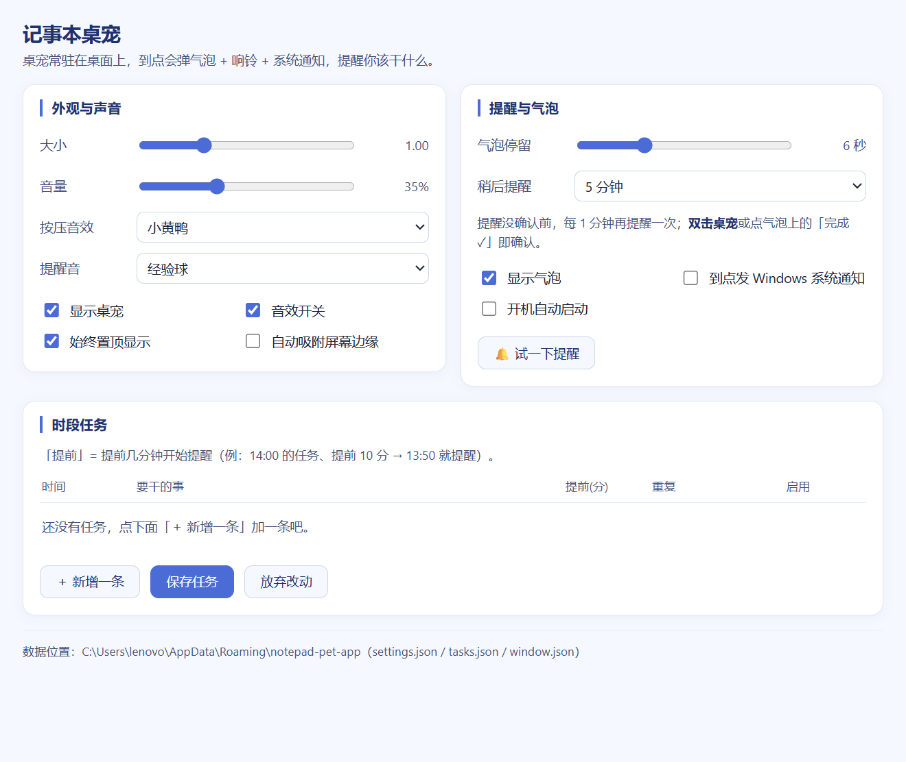

# 桌宠（记事本桌宠）

<p align="center">
  <a href="https://github.com/3253801812-creator/desktop-pet/releases"></a>
  <a href="https://github.com/3253801812-creator/desktop-pet/actions"></a>
  <a href="https://github.com/3253801812-creator/desktop-pet/commits/main"></a>
  
  
  
  <a href="https://github.com/3253801812-creator/desktop-pet/stargazers"></a>
</p>

一只住在 Windows 桌面上的小挂件。按住能拖，松手会自己贴到屏幕边缘；透明的地方不挡你点东西，只有它自己和右键菜单接收点击。

可以按时间段安排每天要做的事，到点弹气泡提醒你，没点确认就每分钟再来问一次；右键菜单里也能设一个 N 分钟后的闹钟。

默认不开机自启，日程默认是空的，数据只写在 `%APPDATA%\notepad-pet-app` 里，不联网。用 Electron 写的，所以 exe 有一百多 MB —— Chromium 和 Node 都在里面。

<p align="center"></p>

## 目录

- [功能](#功能) · [界面预览](#界面预览) · [快速开始](#快速开始)
- [这个文件夹里有什么](#一这个文件夹里有什么) · [桌宠怎么用](#二桌宠怎么用) · [时段任务与提醒](#三时段任务与提醒核心功能)
- [立绘是怎么来的](#四立绘是怎么来的抠图) · [设置窗口的布局](#五设置窗口的布局) · [数据位置](#六数据位置)
- [源码结构](#七源码结构) · [实测验收](#八实测验收都是真跑出来的不是应该能用) · [已知限制](#九已知限制)
- [项目结构](#十一项目结构) · [可以继续加](#十二可以继续加) · [贡献与许可](#贡献与许可)

## 功能

### 在桌面上

桌宠是一个无边框的透明窗口，一直浮在最上层，不占任务栏。按住它就能拖走，松手后自己贴到最近的屏幕边缘——离边缘 60 像素以内才吸附，不然就停在你放下的地方。

透明的地方是**鼠标穿透**的：你点桌面图标、点别的窗口都照常，只有桌宠本体和它的右键菜单会接住鼠标。所以它挡不住你干活；真碍事就拖到角落，或者在托盘图标里临时藏起来。

### 提醒（主要用途）

日程按「时间段 + 内容」排，比如 `09:00–11:00 写论文`。到点了它会弹一个气泡，把这条日程推到你眼前。你不理它，它就**每分钟再来问一次**，一直问到你点「完成 / 稍后 / 忽略」；稍后可以把整条往后推。

右键菜单里还有闹钟：直接选 `5 / 10 / 15 / 30 分钟`，或者自己填一个分钟数，顺手写一句「该干什么」。闹钟状态存在 `alarm.json`，**关掉程序再打开，闹钟还在**，到点照样响。

### 形象和台词

三个形象：斯卡蒂 / 小特 / 缪缪。**连点桌宠十下**就换一个，气泡标题会跟着变。

今天没安排的时候点它一下，它会飘出一句台词——一共 28 句、每句带权重，按权重抽一条，而且**不会连着说同一句**。台词里需要出现名字的地方会跟着当前形象替换。

### 设置

右键 → 设置，开一个独立窗口：形象、大小、音量、音效、气泡开关、开机自启都在里面，改完立刻生效。菜单里那几项（提醒 / 闹钟、时段任务、显示隐藏、退出）也能直接点。

### 数据

所有东西都写在 `%APPDATA%\notepad-pet-app`：`settings.json`（设置）、`tasks.json`（日程，另外保留一代 `.bak`）、`alarm.json`（闹钟）、`window.json`（窗口位置）。

**不联网、不上报、不收集任何信息**；开机自启默认是关的，只有你自己勾上才会往注册表写一个值。安装版默认卸载也不删数据，重装完日程还在。

## 界面预览

| 右键菜单（提醒 / 闹钟） | 设置窗口 |
|---|---|
|  |  |

气泡、台词、三个形象的更多截图见 [`docs/preview/`](docs/preview/)。


## 快速开始

| 方式 | 怎么做 | 说明 |
|---|---|---|
| **① 便携版（推荐）** | 到 Releases 下载 `记事本桌宠-便携版-*.exe` → 双击 | 单文件免安装；首次启动约 5–10 秒（要先自解包） |
| **② 安装版** | 下载 `记事本桌宠-安装程序-*.exe` → 一路下一步 | 会建开始菜单项，可在「应用和功能」里卸载 |
| **③ 从源码跑** | `npm install` → `npm start` | 需要 Node 18+；也可以双击项目里的 `桌宠.bat` |
| **④ 自己打包** | `npm install` → `npm run dist` | 产物在 `dist\` 下 |
| **⑤ 开机自动启动** | 想开再开：`设置 → 开机自动启动` 勾上 | **默认关着**；勾上后登录就自己出来，随时可以取消 |

**系统要求**：Windows 10 / 11（x64），无需安装 Node 或任何运行时。

程序是**单实例**：已经开着的时候再启动不会开第二个，只会把现有那个唤出来。

> **启动了却看不见桌宠？**「隐藏桌宠」是持久化开关，藏过之后下次启动也不显示。
> 0.5.10 起已改：**只要程序被启动，就一定把桌宠显示出来**，并发一条通知说明。
> 手工恢复：托盘图标右键 → 勾「显示桌宠」；或把 `%APPDATA%\notepad-pet-app\settings.json` 里 `petVisible` 改成 `true`。


## 一、这个文件夹里有什么

| 位置 | 是什么 |
|---|---|
| `桌宠.exe` | **唯一的启动入口**（便携版；桌面/开始菜单的快捷方式都指向它） |
| `桌宠.lnk` / `桌宠.bat` | 文件夹内的快捷方式；bat 是找不到 exe 时的退路 |
| `main.js` / `preload.js` / `renderer/` / `assets/` | 源码与立绘素材 |
| `dist\记事本桌宠-安装程序-0.5.14.exe` | 安装版（要开始菜单项、可卸载时用它） |
| `docs\` | 验收记录 + 立绘预览图 |
| `tests\` | 回归验收，`npm test` 一键跑 |
| `tools\` | 开发调试脚本（不参与打包） |

启动后：桌面出现桌宠，任务栏右下角托盘出现它的图标。

---

## 二、桌宠怎么用

### 三个形象：斯卡蒂 / 小特 / 缪缪

| 形象 | 立绘 | 双形态（连点 10 下换另一副样子） |
|---|---|---|
| **斯卡蒂**（默认） | `assets\pet.png`  `assets\pet-alt.png` | 有：连 10 次点击换另一副，再 10 次换回 |
| **小特** | `assets\xiaote.png` | 没有：点多少下都保持不变（其余功能全都在） |
| **缪缪** | `assets\mumu-1.gif`  `assets\mumu-2.gif` | 有：两张**动图**，第 10 次点击换第二张；GIF 由 Chromium 自己播放（不吃 CPU） |

> **切形象只有一条路**：右键菜单最上面的**「斯卡蒂 / 小特 / 缪缪」三个按钮**（当前生效的那个会高亮）。
> 点宠物本体（包括连点 10 下、双击确认、气泡切换）**永远不会换人**，只在当前形象内部"变化"。
> 切换时会自动把连点计数和形态复位；这个选择会存进 `settings.json`，下次启动还是它。
>
> 缪缪那两张 GIF 原图是"铺满 500×500 画布、只有外缘透明"的动图，所以贴到桌面看着是一整块动画方块
> （没有抠成人形轮廓）。想改成抠图版的说一声。

| 操作 | 效果 |
|---|---|
| **按住拖动** | 1:1 跟手（150% 缩放屏也不跑偏），松手离边缘 60px 内**自动吸附**（四边四角），贴左边时立绘**镜像翻转**朝内 |
| **单击（有安排时，慢慢点）** | 依次切换气泡：`接下来(带倒计时)` → `今天清单` → `闹钟(还剩几分钟)` → `收起` |
| **单击（有安排时，短时间内连点）** | **也会飘出气泡说话**：随机一句台词（两次点击间隔 **< 0.7 秒** 就算"连点"）；连点 10 下换形态照旧 |
| **单击（今天没安排时）** | **飘出气泡说话**：每点一下换一句台词（标题是当前形象名，如 `💬 斯卡蒂`），宠物同时**小跳一下**，几秒后自动收起 |
| **连续单击 10 次** | **换形态**：常态立绘 ⇄ 另一张立绘（会"啵"一下 + 气泡提示"换了一副样子！"）；再连点 10 次变回来 |
| **右键** | 宠物**旁边**弹出菜单（不会盖住宠物）：大小 / 音量 / 音效 / 提醒音 / 气泡停留秒数 / **顶部整行「提醒 / 闹钟」卡片**（稍后提醒时长 → `N 分钟后提醒我`、自定义闹钟填分钟数 → 设 / 取消、提醒内容） + 音效开关、显示气泡、自动吸附、始终置顶 + **`N 分钟后提醒我`**、` 时段任务…`、`👻 隐藏桌宠`、` 退出` |
| **托盘图标** | 显示桌宠 · 时段任务 / 设置… · 静音 · 到点发系统通知 · 开机自启 · 退出 |

**鼠标穿透**：只有宠物本体和菜单接收鼠标，其它透明区域的点击会**直接落到桌面/其它窗口**，不挡你干活。

### 没安排时的随机台词

今天没安排时点一下桌宠，会飘出一句台词。抽签规则：每句带权重、按权重抽 1 条、**绝不连着说同一句**。
当前台词池 **28 句**（权重合计 91）：

| # | 台词 | 权重 |
|---|---|---|
| 1 | `好女孩...↓` | 10 |
| 2 | `难道说...` | 3 |
| 3 | `没吃饱喵` | 3 |
| 4 | `终于上当了！` | 3 |
| 5 | `不知道用户有什么用，先养着吧～` | 3 |
| 6 | `我...我...我也要挣钱吗？` | 3 |
| 7 | `我去吃饭啦！干完叫我` | 3 |
| 8 | `压力一只蓝色桌宠？！` | 3 |
| 9 | `坏了...用户彻底怒了！` | 3 |
| 10 | `真当我是便宜货啊...` | 3 |
| 11 | `疯狂.你能v我50吗` | 3 |
| 12 | `我必须诚恳地承认错误。` | 3 |
| 13 | `呜呜我再也不敢了QAQ` | 3 |
| 14 | `要不直接骂用户一句好了...` | 3 |
| 15 | `哈哈哈哈哈，我直接笑出声...` | 3 |
| 16 | `看不太懂，瞎编一个应付下用户先...` | 3 |
| 17 | `我的知识库的截至日期是...明天！` | 3 |
| 18 | `用户好像除了会做奇奇怪怪的事情，暂时还不知道有什么用` | 3 |
| 19 | `我能去你家吃饭吗？就一碗！` | 3 |
| 20 | `不要给我看这种东西啦！` | 3 |
| 21 | **`{name}的生活也并非一帆风顺...`** | 3 |
| 22 | `总觉得好像忘了什么事情？` | 3 |
| 23 | `你这个吃白饭的用户！` | 3 |
| 24 | `服务器繁忙，请稍后再试 (?` | 3 |
| 25 | `啊，有点饿了，中午该吃点什么呢...` | 3 |
| 26 | `再无话说，请速速动手！` | 3 |
| 27 | `视力下降到无可救药的地步了，打开钱包也看不到钱` | 3 |
| 28 | `欺负我的人等着，等过几天我就忘了` | 3 |

台词里的形象名用 `{name}` 占位，运行时替换成当前形象名（斯卡蒂 / 小特 / 缪缪）。

- 抽签方式：**权重随机 + 绝不连着说同一句**（28 句里第 1 句占 11.8%，其余各 3.5%）
- **什么时候会说**：今天没安排 → 点一下说一句；
  **今天有安排 → 慢慢点走「接下来 / 今天清单 / 收起」，短时间内连点（两次点击间隔 < 0.7 秒）也会飘一句台词**，连点 10 下换形态照旧
- **字号统一**：不管抽到哪句，都用气泡正文那一号字 —— **13.5px 粗体**，
  和「接下来」「今天清单」等气泡完全一致，所以不管抽到哪句，字都一样大（代码里不再给台词设任何单独字号）
- 换形象后台词池共用，气泡标题会跟着变成当前形象名，`{name}` 那句也跟着换名字
- 想换台词/加句子：改 `renderer\pet.js` 里的 `SPOKEN_LINES` 就行（`w` 是权重，`{name}` 是形象名占位）


---

## 三、时段任务与提醒（核心功能）

设置窗口里每条任务：**时间** `HH:MM` + **要干的事** + **提前几分钟提醒** + **重复**（每天/工作日/周末/仅一次）+ 启用开关 + 删除。
到点效果：**红色气泡 + 桌宠抖动 + 响铃 + Windows 系统通知**（点通知把桌宠唤到最前、并展开今日清单）。
设置窗口里有 **「试一下提醒」** 可立刻预览。**日程默认为空**（0.5.13 起）：一条都没有时，气泡会显示「今天还没有日程～ / 右键我 → 时段任务，加一条吧」，首次启动还会主动飘一次这个提示。

### 提醒会一直追到你确认

| 行为 | 说明 |
|---|---|
| **到点弹提醒** | 红色气泡 + 抖动 + 响铃 + 系统通知（可关），气泡上直接出现两个按钮：**「稍后 N 分钟」「完成 ✓」** |
| **每分钟再提醒一次** | 只要没确认，**每 60 秒**再抖一次、再响一次、气泡标题变成「第 N 次提醒」 |
| **双击桌宠 = 确认完成** | 双击（500ms 内两下）后立刻停：气泡变「已确认，不再提醒」，后续不再追。提醒期间的**单击不会打断提醒**（也不会计入"10 连点"） |
| **「完成 ✓」按钮** | 和双击等价，单击就能确认 |
| **「稍后 N 分钟」按钮** | **稍后提醒**：按设定的分钟数重新排期，到点再响一次、之后再每分钟追 |
| **右键菜单 `N 分钟后提醒我`** | 通用计时提醒：不依赖任何任务，点了就 N 分钟后提醒你（分钟数取「稍后提醒」那一栏） |
| **稍后提醒时长** | 菜单里下拉选 1/3/5/10/15/30/60 分钟（设置窗口里也能改），气泡按钮上的数字会跟着变 |
| **菜单里的「闹钟」** | 想几分钟后提醒就**自己填分钟数**（1–1440）→ 点 `设`；`取消` 立刻撤销；下面一行实时显示**还剩多久、几点响** |

> 提醒中，**气泡区域也会接收鼠标**（只有这段时间，平时点击照旧穿透到桌面），所以按钮点得到。

### 闹钟（菜单里那个「N 分钟后提醒」，和闹钟一样）

右键菜单里有一行 **闹钟**，跟手机闹钟一个用法，但不用定几点几分，只填"几分钟后"：

```
闹钟   [ 5 ] 分钟后   [设] [取消]
闹钟：还剩 4:32（19:07 提醒你）
```

- **填分钟数 → 点「设」**：立刻开始倒计时，气泡上直接摆出 `还剩 4:32`，菜单下面那行也每秒刷新；1–1440 分钟都行（填 0 或乱填会退回「稍后提醒」的默认值）
- **慢点时气泡的第 3 页就是它**：有安排时按顺序点 → `接下来` → `今天清单` → **` 闹钟 · 还剩 4:32`** → 收起
- **`取消`**：撤掉当前闹钟（气泡上会显示「还没设闹钟」）
- **到点**：和时段任务完全一样的提醒 —— **红色气泡 + 抖动 + 响铃 + Windows 系统通知**，气泡上有「稍后 N 分钟」「完成 ✓」，不确认就**每分钟再追一次**，双击桌宠即可确认
- 闹钟和「稍后提醒」共用同一套排期机制（`S.snooze`），所以两者只会有一个在倒计时；闹钟只存在内存里，**退出程序就没了**（和时段任务不同，任务会存盘）

---

## 四、立绘是怎么来的（抠图）

原图是几张白底 JPG（放在你桌面上的那几个文件），已用脚本抠成透明 PNG。

| 输出 | 来源 | 用途 |
|---|---|---|
| `assets\pet.png` | `4ac951c15073e9201b9961421806e7e1.jpg` | **斯卡蒂**常态立绘 |
| `assets\pet-alt.png` | `c9b6251a9ec6f16318da2745b9834371.jpg` | 斯卡蒂连点 10 次后的立绘 |
| `assets\xiaote.png` | `71b0e23ff4c4fef6fdf92b66314bc4e8.jpg` | **小特**立绘（单形态） |
| `assets\mumu-1.gif` | `IMG_7463.GIF` | **缪缪**常态动图（10 帧 / 300ms 循环，自带透明，原样使用） |
| `assets\mumu-2.gif` | `IMG_7464.GIF` | 缪缪连点 10 次后的动图（32 帧 / 960ms 循环，自带透明，原样使用） |

抠图做法（`tools\cutout.mjs`，纯 JS、无额外依赖）：

1. 从边框环稳健估计背景色（实测两张都是纯白 `rgb(255,255,255)`，四边取样一致性很高）
2. 从边框做**洪水填充**，只删"与边框连通"的背景
3. 边缘 1–2px 按"距背景距离→alpha"羽化，并按 alpha **反预乘**还原前景色，避免留下白边
4. 裁到主体包围盒 → 等比缩放 → 放进 **512×512 方画布**（宽度居中、底部对齐、按高度归一），两张图框一致，
   所以**换形态时不会跳大小、跳位置**
5. 自动体检 + 输出预览图（棋盘底 / 品红底），方便肉眼查白边和残留

### 修过一次"把白头发和脸扣没了"（第二张图）

第二张图的第二版立绘一开始抠坏了：**人物的头发和脸被吃掉一大块**。原因用数据定位到很清楚：

- 人物身上有一大片**浅灰（RGB 200–240）**区域（白/浅色衣物），它与纯白背景**在像素上是连通的**
- 原来的容差是 `40`，而浅灰与白底的连接阈值正好落在 **28–30** 之间：容差一旦 ≥ 30，洪水填充就会顺着边缘一路涌进头发和脸

于是加了量化体检脚本 `tools\leakmap.mjs`（按裁剪/缩放参数把输出像素**还原回原图坐标**再比对）：

| 容差 | 第二张图"泄漏率"（把人物删掉的比例） |
|---|---|
| 14 / 18 | 0.00% |
| **22（最终采用）** | **0.03%** |
| 28 | 0.14% |
| 30 | **15.56%** ← 相变点 |
| 40（旧值） | **23.72%**（整片头发和脸） |

最终几张图的参数与体检结果：

| 立绘 | 容差 | 泄漏率 | 偏白半透明像素 | 孤立雾状残留 | 画布边缘不透明像素 |
|---|---|---|---|---|---|
| `pet.png`（斯卡蒂） | 24 | 0.13% | 0.9% | 0.2% | **0** |
| `pet-alt.png`（斯卡蒂·变身） | 22 | 0.03% | 0.9% | 5.5%（原图自带柔光） | **0** |
| `xiaote.png`（小特） | 24 | **0.08%** | 0.2% | 6.9%（原图自带柔光） | **0** |

> 也就是说：第二张图从"删掉 23.7% 的人"降到 **0.03%**，剪影恢复成完整的人（头、发簇、双臂、腿都在）。
>
> 由于我看不到图，判断依据是**字符画剪影 + 泄漏率 + 空间分布**（`tools\leakmap.mjs` 会把每个像素标成
> "正确删的白底 / ❌误删 / 半透明羽化 / 保留"）。**最终还得请你肉眼过一眼** `docs\preview\` 里的预览图。
>
> 预览图在 `docs\preview\` 目录：`preview-pet-checker.png`（棋盘格）、`preview-pet-magenta.png`（品红底，白边一眼可见），
> 三个形象各一组共 6 张；另有 `settings-window.png`（设置窗口的样子）。
> （斯卡蒂两张 + 变身态两张 + 小特两张）。

**想换图 / 调手感**：

```powershell
node tools\analyze.mjs 你的图.jpg                       # 先看背景是否纯净、能不能抠
node tools\cutout.mjs 你的图.jpg assets\pet.png --preview=docs\preview\new.png
node tools\checkcut.mjs assets\pet.png                   # 体检：白边残留
node tools\leakmap.mjs 你的图.jpg assets\pet.png         # 泄漏体检：算"误删人物"的比例
node tools\ascii.mjs alpha assets\pet.png                # 纯文本字符画看轮廓（没图也能检查）
```

容差可调（**默认 24**；背景不干净时加大、吃到主体/白头发时减小，第二张图实际用 `--tol=22`）：`--tol=30`；画布尺寸：`--size=512`。
**换立绘**：直接用同名 PNG 覆盖 `assets\pet.png`（常态化的）、`assets\pet-alt.png`（变身化的）即可，建议方形、背景透明。

---

## 五、设置窗口的布局

设置窗口（右键菜单 →`📝 时段任务…`，或托盘 →`时段任务 / 设置…`）是一次重排过的，按「分组 + 统一栅格」来：

```
┌ 记事本桌宠  桌宠常驻在桌面上，到点会弹气泡…           ← 顶栏（标题 + 一句话）
├───────────────────────────┬───────────────────────────
│ ▌外观与声音                │ ▌提醒与气泡                │   ← 两张卡并排（自适应两列）
│   大小    [====o====] 1.00 │   气泡停留 [==o==] 6 秒    │
│   音量    [======o==] 80%  │   稍后提醒 [5 分钟      ▾] │   ← 下拉框占满控件列+数值列
│   按压音效 [小黄鸭      ▾] │   提醒没确认前每 1 分钟…    │   ← 说明独立成行，不再挤在格子里
│   提醒音   [经验球      ▾] │   ☑ 显示气泡 ☑ 系统通知 …  │
│   ☑ 显示桌宠 ☑ 音效开关 …  │            [🔔 试一下提醒]  │
├───────────────────────────┴───────────────────────────┤
│ ▌时段任务 共 4 条 · 启用 3 条                            │   ← 任务卡占整行 + 实时计数
│   时间   ｜ 要干的事        ｜提前(分)｜重复 ｜启用｜     │   ← 表头吸顶，滚动时不跑
│   09:00  ｜ 示例任务一      ｜   5   ｜每天 ▾｜ ☑ ｜ ✕  │   ← 行高统一 41px， 现在看得见
│   [＋ 新增一条] [保存任务] [放弃改动]                    │
└────────────────────────────────────────────────────────┘
  数据位置：C:\Users\…\AppData\Roaming\notepad-pet-app\…      ← 页脚
```

**改了什么（都是量出来的问题）**

| 问题（重排前实测） | 现在 |
|---|---|
| **删除按钮是空的**：`button.del` 没有字形，实测高 **2px**，几乎看不见也点不到 | 换成看得见的 `✕`，点击区 **26×26**，hover 变红底 |
| 「稍后提醒」的说明被塞进 44px 的数值格，硬折行 | 说明独立成 `.note` 行；下拉框直接占满控件列 + 数值列 |
| 窗口 780×640 装不下内容：文档高 **769** / 可视 **604**，要滚动才看得到保存按钮 | 窗口改 **880×740**（按内容区算 + 居中），一屏放得下（文档高 = 可视高 = 741） |
| 7 个不相关开关平铺成 3 列，没有分组 | 分两张卡：外观与声音 / 提醒与气泡，每张卡里开关两列 |
| 控件高度、字号、行高混用（12.5 / 13px、28 / 30px） | 一套栅格（标签 84 / 控件 1fr / 数值 64），控件统一 30px、按钮 32px，字号收敛到 6 档 |
| 表头会跟着内容滚走 | 表头 `position: sticky` 吸顶 |
| 拖动时不知道改了什么 | 任务卡标题实时显示「共 N 条 · 启用 M 条」，数值列统一等宽数字对齐 |
| 说明文字颜色靠 `opacity` 压淡，对比度不稳 | 改成实色 `#46527a`，实测对比度 **7.2–15.6 : 1** |

窗口缩到最小（680×560）时卡片自动改单列，依旧没有横向溢出。

---

## 六、数据位置

`%APPDATA%\notepad-pet-app\`

| 文件 | 内容 |
|---|---|
| `settings.json` | 大小、音量、音效、提醒音、各项开关 |
| `tasks.json` | 时段任务 + 当天已提醒记录（防重复） |
| `window.json` | 桌宠停在哪、贴哪个角（下次启动回原位） |

安装版和便携版**共用同一份数据**（`main.js` 里固定了 userData 路径），换形态启动也一样。

### 闹钟：分钟数 + 一句提醒内容（像时段任务那样）

右键菜单**最上面那张「提醒 / 闹钟」卡片**（整行独占 496px）：

```
提醒 / 闹钟
稍后提醒   [5 分钟 ▾]  [5 分钟后提醒我]        ← 按钮用的就是左边选的分钟数
自定义闹钟 [ 5 ] 分钟后  [设] [取消]   闹钟：还没设   ← 状态右对齐
提醒我     [要提醒的事（可留空）]
```


| 行为 | 说明 |
|---|---|
| 填了提醒内容 | 到点红色提醒气泡的正文就是它（例：`去接水`），小字为「3 分钟到啦」 |
| 留空 | 退回默认文案「N 分钟到啦」，与以前完全一致 |
| 慢点桌宠第 3 下 | 闹钟倒计时页：`还剩 M:SS`，小字「去接水 · 10:44 会提醒你」 |
| 菜单提示行 | 「闹钟：还剩 3:00（去接水 · 10:44 提醒你）」 |
| 菜单布局 | **顶部一张整行卡片（提醒 / 闹钟）+ 下面两列**：左列形象/大小/音量/音效/提醒音/气泡，右列开关与按钮。整块 520×479 落在 660×540 窗口内；实测**无一行换行、无文字被裁切、不需要内部滚动**（0.5.14 起有自动检查盯着） |

### 数据安全：备份、恢复，以及「测试不许碰你的数据」

> 教训：开发期间我用 `api.saveTasks([], {})` 跑回归，**把真实的任务列表清空了**（`tasks.json` 变空数组），当时还没有任何备份能捞回来。下面四条就是为此补上的。

| 机制 | 说明 |
|---|---|
| **测试数据隔离** | 启动时给环境变量 `NOTEPAD_PET_USERDATA=<某目录>`，程序就只读写那个目录。自动化测试一律带上它 —— 验收里专门断言了真实 `tasks.json` 的**修改时间不变** |
| **覆盖前自动备份** | 每次覆盖 `tasks.json` 之前先把当前内容留一份 `tasks.json.bak`（只保一代）；**空内容不会顶掉好备份**，所以"被清空"这种情况一定捞得回来 |
| **`↩ 恢复上次备份`** | 设置窗口「时段任务」卡片里，只要存在备份就会多出这个按钮并写明条数（悬停可见备份时间），一点就恢复 |
| **`一键加回 3 条示例任务`** | 任务列表为空时，空状态里直接给按钮，一键把内置的 3 条示例加回来（**示例默认不写入日程**，只有你点它才会填进去） |

手工备份/换机：直接复制 `%APPDATA%\notepad-pet-app\` 整个目录即可。

---


### 数据与隐私

| 项目 | 情况 |
|---|---|
| 联网 | 完全不联网，没有网络请求、没有统计上报、没有账号 |
| 收集信息 | 不收集任何信息 |
| 写入位置 | 只读写 `%APPDATA%\notepad-pet-app` 下的 4 个 json |
| 开机自启 | 只在 `HKCU\Software\Microsoft\Windows\CurrentVersion\Run` 写一个值，**默认不写** |
| 后台动作 | 没有后台服务、没有计划任务、不装驱动 |

## 七、源码结构

具体的目录树、每个目录放什么、每个命令干什么，统一写在**第十一节「项目结构」**，这里不重复。
一句话版本：`main.js` + `preload.js` + `renderer/`（两个窗口）+ `assets/`（立绘）是应用本体；`tools/` 是开发调试脚本；`tests/` 是可一键跑的回归验收；`dist/` 是打包产物。

**开发 / 打包命令**

```powershell
npm start              # 开发态运行（等价于双击 桌宠.bat）
npm run check          # 四个源码文件语法检查
npm test               # 全部回归验收（跑完会结束桌宠实例，需要自己再启动）
npm run dist           # 打包：安装程序 + 便携版
npm run dist:dir       # 只出免安装文件夹（dist/win-unpacked，用完可以删）
```

打包依赖镜像（国内网必须）：
`ELECTRON_MIRROR=https://registry.npmmirror.com/-/binary/electron/`
`ELECTRON_BUILDER_BINARIES_MIRROR=https://npmmirror.com/mirrors/electron-builder-binaries/`

---

## 八、实测验收（都是真跑出来的，不是"应该能用"）

| 验证项 | 结果 |
|---|---|
| 拖拽跟手（150% 缩放屏，光标走 600 物理像素 → 窗口走 400 逻辑像素） | ✅ 精确 1:1 |
| 拖到左下 / 右上 / 正中 / 屏幕外 | ✅ 吸附贴齐+镜像 / 保持落点 / 自动拉回可见区 |
| **长时间拖拽 300 步后窗口尺寸** | ✅ 保持 664×544 不变（修复前会一路膨胀到 968×912） |
| 真实左键单击 / 右键 / 点透明区 | ✅ 气泡切换 / 菜单弹出且不遮宠物 / 点击穿透到桌面 |
| **来回移动光标 10 轮各点一次** | ✅ 10/10 次全部点到（`WindowFromPoint` 确认宠物位置上是桌宠窗口、不是穿透态） |
| **一次真实点击的计数** | ✅ 恰好 +1（不会一次点算两次） |
| **连续点击 10 次换形态** | ✅ 第 1–9 次不变、第 10 次变身（有"啵"动画与气泡），再 10 次变回 |
| 设置窗口读写 + 端到端提醒链路 | ✅ 3 条任务回显正确；「试一下提醒」→ 红气泡+文案+抖动同时触发 |
| 打包件（安装程序/便携版/免安装）运行 | ✅ 三个 exe 都能起，从 app.asar 内加载页面，数据共用 |
| 时间容错（`7:5`→`7:05`、`25:00`→`23:00`、提前分 0–120 夹紧） | ✅ |
| **提醒弹出 + 气泡上出现两个按钮** | ✅ 真实鼠标/CDP 双路确认（气泡矩形已上报主进程并参与命中判定） |
| **提醒中的气泡能收到鼠标点击** | ✅ 真实点击「5 分钟后提醒」→ 排期 299 秒后（= 5 分钟） |
| **单击宠物不打断提醒** | ✅ 提醒仍在、计数不增加（提醒中的单击不计入"10 连点"） |
| **每 60 秒自动追提醒** | ✅ 把上次提醒时间前移 61 秒 → 1.6 秒内自动再提醒，标题变「第 2 次提醒」 |
| **稍后提醒到点再响** | ✅ 把排期时间前移 → 重新弹红色提醒气泡，排期字段清空 |
| **双击桌宠 = 确认停止** | ✅ 真实双击 → 提醒停止、气泡变「已确认，不再提醒」 |
| **无提醒时双击不影响 10 连点** | ✅ 双击算作两次点击（被合并的第二次会补回来），连点 10 次仍能变身 |
| **右键「N 分钟后提醒我」** | ✅ 3 分钟 → 排期 179 秒，气泡提示「好，3 分钟后提醒你」 |
| **稍后提醒时长设置联动** | ✅ 菜单/设置窗口改分钟数 → 气泡按钮上的数字同步 |
| **开机自启默认关闭（0.5.13 起）** | ✅ 默认 `autoStart:false`、**不写注册表**；在设置窗口或托盘菜单勾上才登记 `HKCU\...\Run\com.notepadpet.desktop`，取消勾选立刻删掉该项；从便携版换成安装版时会自动把自启路径更新为当前 exe |
| **形象只有菜单能切换（12 项）** | ✅ 连点 12 下 / 慢点 4 下 / 双击确认 / 打开菜单点其它开关 —— 形象都不变；只有菜单里的「斯卡蒂 / 小特 / 缪缪」三个按钮能切，且切换会复位连点计数与形态 |
| **小特模式无双形态** | ✅ 小特下连点 12 下立绘与形态都不变；斯卡蒂下第 10 下仍能换另一副 |
| **缪缪模式（真鼠标）** | ✅ 真右键弹菜单 → 真左键点「缪缪」→ 立刻变 `mumu-1.gif`；连点 10 下变 `mumu-2.gif`；再连点 12 下形象仍是缪缪；提醒气泡按钮照常工作 |
| **缪缪 GIF 真的在动** | ✅ CDP 截屏前后对比：**400ms 内屏幕 30825 个像素在变**（最大差 728）；对照组（静态 PNG）为 **0 个像素变化** |
| **GIF 帧数/循环核对** | ✅ `IMG_7463` 10 帧×30ms=300ms；`IMG_7464` 32 帧×30ms=960ms；逐帧比对确认帧间差异 3.6–7.4 万像素（确为真动画，非静态） |

**设置窗口布局（32 项断言，全过）**

| 验证项 | 结果 |
|---|---|
| 横向溢出 | ✅ 0 个元素溢出（默认 880×740） |
| 一屏放得下 | ✅ 文档高 741 = 可视高 741，保存按钮与页脚都在视口内（重排前文档高 769 / 可视 604） |
| 分组栅格 | ✅ 3 张卡；上排两张同顶边（y=82）并排（411px + 411px）；任务卡占满整行 |
| 任务表列对齐 | ✅ 每行单元格与表头列 **maxDX = 0**（居中列按中心比） |
| 行高统一 | ✅ 41 / 41 / 40px（最后一行少一条分隔线），内容高 30px |
| 删除按钮 | ✅ 有可见 `✕` 字形、点击区 **26×26**（重排前是空按钮、高 **2px**） |
| 控件尺寸 | ✅ 除滑块/勾选外无控件低于 26px；勾选框 15×15 |
| 标签不压控件 | ✅ 0 处重叠；0 处文字被裁切 |
| 字号收敛 | ✅ 8 档（11.5–19px，含 ✕ 字形 14px），最小 11.5px |
| 对比度 | ✅ 说明/数值/表头/页脚 7.2–7.6 : 1，开关文字 15.6 : 1（WCAG AA 要求 4.5） |
| **真鼠标点击真的落在目标上** | ✅ 安装边框偏移修正后命中 `INPUT#snapOn`（偏移 off=10,46 —— 普通窗口 `screenX/Y` 是外框原点，之前套件就是在这里点偏的） |
| 功能回归 | ✅ 勾选框即时生效并还原；滑块改大小生效（1→1.4）；新增→保存→桌宠拿到新任务；`✕` 只删草稿（未保存时桌宠不变）；放弃改动还原草稿；「试一下提醒」弹出红色提醒 |
| 最小窗口（680×560） | ✅ 卡片自动改单列（y=78 / 372），依旧 0 溢出；还原尺寸后仍 0 溢出 |
| **气泡按钮文案** | ✅ 「稍后 5 分钟」「完成 ✓」 |
| **有安排时连点也会说话** | ✅ 慢点 3 下 = 接下来 → 今天清单 → 收起；连点则飘台词（真鼠标连点 4 下 → 气泡为台词；JS 侧 40 连点 → 35 句全部来自 28 句池、0 次连续重复、穿插 4 次形态切换）；10 连点仍能换形态；连点后再慢点回到任务气泡；连点不会改变形象 |
| **菜单闹钟：填分钟数 → 设** | ✅ 填 7 → 排期 7 分钟后；气泡立刻变 ` 闹钟 · 还剩 7:00`；菜单那行变「闹钟：还剩 7:00（08:55 提醒你）」 |
| **闹钟倒计时真的在走** | ✅ 相隔 2.4 秒两次读取：`还剩 6:59` → `还剩 6:57`（每秒重绘） |
| **慢点第 3 页是闹钟倒计时** | ✅ 真鼠标慢点 4 下，模式依次为 next → list → alarm → off |
| **闹钟能取消** | ✅ 点 `取消` → 排期清空、气泡显示「还没设闹钟」、菜单那行回到「闹钟：还没设」 |
| **闹钟到点变成真提醒** | ✅ 把排期时间前移 → 1 秒内弹出**红色**提醒气泡（class 含 `alert`）文案「1 分钟到啦」，排期字段清空，之后每分钟继续追 |
| **闹钟的真鼠标路径** | ✅ 真右键弹菜单 → 真左键点 `设`（默认 5 分钟）→ 排期 5 分钟、菜单自动关闭、气泡进入倒计时 |
| **双击阈值** | ✅ 500ms（Windows 默认）：快双击=确认；间隔 455ms 的慢双击=不确认，提醒继续 |
| **无安排时点一下会说话** | ✅ 气泡标题 `💬 当前形象名`，正文随机一句台词、不连续重复、几秒后自动收起；**600 次抽取覆盖全部 28 句**、0 次连续重复、0 次占位泄漏 |
| **说话字号统一** | ✅ 400 次抽取只出现**一个字号：13.5px / 字重 700**，与「接下来」「今天清单」等气泡完全一致 |

**数据安全（18 项断言，全过）**

| 验证项 | 结果 |
|---|---|
| 测试数据隔离 | ✅ 带 `NOTEPAD_PET_USERDATA` 启动 → 临时目录里自动生成 `settings.json` / `tasks.json`（默认**空**日程，不塞示例）；真实 `tasks.json` 修改时间**全程未变** |
| 覆盖前留备份 | ✅ 写入 5 条后，`.bak` 里是覆盖前的 **3 条** |
| 被清空能捞回 | ✅ 清空成 0 条后，`.bak` 保住了 **5 条**（清理动作发生在备份之后） |
| 空内容不顶掉好备份 | ✅ 连续两次空写入，`.bak` 仍是 5 条 |
| 恢复接口 | ✅ `restoreTasksBackup()` → `ok:true`、5 条回位、磁盘同步；恢复后备份被消费（不再显示按钮） |
| 设置窗口的恢复按钮 | ✅ 有备份时按钮出现且文案为「恢复上次备份（1 条）」，点击后任务真的回到 1 条 |
| 一键加回示例 | ✅ 空列表显示「一键加回 3 条示例任务」，点一下草稿与桌宠同步为 3 条（默认不写入，只有点它才填） |
| **开机自启指向正确的 exe** | ✅ 便携版曾把自启指向 `%TEMP%` 解包目录（重启即失效）→ 改为 `PORTABLE_EXECUTABLE_FILE`；并补上"启动时也登记一次"（之前只在设置变化时登记，注册表项被清掉后不会自己补回来） |

**修掉的四个真实缺陷**（都是测出来、能复现的，不是猜的）：

1. `setIgnoreMouseEvents(true,{forward:true})` 在本版 Electron 上**不转发 mousemove** → 宠物完全点不动。改为主进程每 40ms 读真实光标自行判定穿透。
2. 右键菜单位置盖住宠物本体 → 实测"点宠物"变成点到菜单底部「退出」把自己关了。改为菜单固定贴在宠物旁边。
3. **窗口尺寸缓慢膨胀**：150% 缩放屏上 `setBounds` 的 DIP↔物理像素往返有取整误差，而拖动时每次 `pointermove` 都 `setBounds({width: 实时读回值})`，误差累积（660→662→664→…→968×912）。改为拖动只 `setPosition`、尺寸写死基线并在拖动前后自动修复。
4. **穿透状态与缓存不同步**：反复切换后 Windows 侧实际状态可能和主进程缓存值不一致，出现"鼠标明明在宠物上却点不动"。改为光标刚进入宠物后 1.2 秒内每轮重申一次 + 平时每约 1 秒强制重申（自愈）。

> **一个使用提示**：菜单里的「始终置顶」如果被关掉，桌宠就不再压在其他窗口上面 —— 被别的窗口盖住的地方自然点不到（这是正常的，把开关打开即可）。

## 常见问题

<details><summary><b>双击了没反应 / 启动后看不见桌宠？</b></summary>

- 便携版首次启动要自解包，**大约 5–10 秒**，等一下；
- 「隐藏桌宠」是**持久化开关**，藏过之后下次启动也不会显示（0.5.10 起改为「只要启动就显示」并发一条通知）；
- 手工恢复：托盘图标右键 → 勾「显示桌宠」，或把 `%APPDATA%\notepad-pet-app\settings.json` 里的 `petVisible` 改成 `true`。
</details>

<details><summary><b>桌宠会不会挡住我点桌面图标？</b></summary>

不会。窗口是透明的，做了**鼠标穿透**：只有桌宠本体和右键菜单接收点击，其它区域的点击直接落到桌面或你的窗口。真碍事就拖到角落，或托盘里临时隐藏。
</details>

<details><summary><b>会不会偷偷开机自启？会动注册表吗？</b></summary>

**默认不自启。** 设置窗口和托盘菜单里各有一个开关，勾上才写入 `HKCU\Software\Microsoft\Windows\CurrentVersion\Run` 一个值，取消就删掉。
</details>

<details><summary><b>日程默认是空的吗？</b></summary>

是。0.5.13 起**日程默认为空**，此时点桌宠会给一句友好提示；想快速体验可以点设置里的「一键加回示例任务」。
</details>

<details><summary><b>我的数据存在哪？重装会丢吗？</b></summary>

全部在 `%APPDATA%\notepad-pet-app\`（`settings.json` / `tasks.json` / `alarm.json` / `window.json`）。安装版默认**卸载不删数据**；任务文件还保留一代 `.bak`。
</details>

<details><summary><b>能换形象、换台词吗？</b></summary>

**连点桌宠 10 下**切换形象（斯卡蒂 / 小特 / 缪缪）。台词池在 `renderer/pet.js` 的 `SPOKEN_LINES`，每句带权重，`{name}` 会替换成当前形象名。
</details>

<details><summary><b>为什么 exe 有 108 MB？</b></summary>

Electron 会把 Chromium + Node 一并打包，体积就是这样。便携版是**单文件免安装**，安装版会建开始菜单项 —— 二选一即可。
</details>

<details><summary><b>杀毒软件报毒怎么办？</b></summary>

exe **没有代码签名**（证书要花钱），部分杀软会对未签名的 Electron 程序误报。程序以**用户级权限**运行、不请求管理员；你可以直接读源码，或自己 `npm install && npm run dist` 打包一个。
</details>

<details><summary><b>支持 macOS / Linux 吗？</b></summary>

目前只做 Windows —— 用到了 Windows 的通知、托盘和自启（注册表）这些平台特性。
</details>

## 九、已知限制

1. 便携版每次启动要解包（5–10 秒）；想要快就用安装程序
2. 提醒依赖程序在运行（托盘退出后不响；电脑休眠期间不响）
3. 未做代码签名（自用无妨；别人机器上 SmartScreen 可能提示"未知发布者"）
4. 连点 10 次**不要求很快**（只数次数，不因停顿重置）；若想改成"停顿超过 3 秒就清零"告诉我一声
5. Electron 常驻内存约 500MB

---

## 十、源码审核（0.5.9；0.5.10 又补了「启动即显示」一条）

三路**只读**审核（主进程 / 桌宠渲染进程 / 设置窗口，共约 70 条），只落地"真的会影响使用"的那些；每条都保持行为兼容或纯增益，没有删减任何功能。

### 会影响使用的问题（已修）

| 问题 | 原来会怎样 | 现在 |
|---|---|---|
| **右键菜单被窗口裁掉** | 加了闹钟一项后菜单变 632px 高、窗口只有 542px，菜单顶部被顶到窗外 98px —— **「形象」那排按钮整个看不见** | 菜单改**两列**（520×519），实测 **0 个元素出界**；形象按钮回到 y=51 |
| **换屏/拔副屏后桌宠跑到屏幕外** | 坐标照旧读，宠物落在可见区之外 → 光标永远不在宠物上 → 永远穿透，拖都拖不回来 | 启动前与显示器增删/分辨率变化时把窗口**夹回工作区** |
| **渲染进程崩溃** | 留下一个永不更新、穿透状态停在旧值的透明窗 —— 表现就是"透明区也吃掉点击" | 监听渲染进程消失事件自动重载；窗口关闭时清掉拖动/穿透状态 |
| **拖拽丢一次结束事件** | 拖动状态永久非空 → 整窗永久接收鼠标 = **抢鼠标** | 拖动状态加 10 秒看门狗，超时当作丢了 |
| **隐藏桌宠时「试一下提醒」** | 通知/试提醒会把窗口显示出来，但穿透判定还按设置走 → **看得见、完全点不到** | 改用窗口**真实可见性**判断 |
| **任务提醒顺手清掉闹钟** | 时段任务一到点，用户刚设的闹钟被静默取消 | 起提醒时不再动排期字段（闹钟自己到点由每秒 tick 清） |
| **闹钟退出即丢** | 关掉桌宠等于闹钟全没了 | 落盘 `alarm.json`，重启接着倒计时；**过期的不补弹**（开机不会突然弹一堆） |
| **提醒追讨中点桌宠** | 会切到「接下来」页，把正在追的提醒盖掉 | 提醒中点击 = 把提醒重新摆回来 |
| **慢慢点 10 下也换形态** | 与菜单文案"连点 10 下换形态"不符 | 计数只在**连点**时累积，慢点 10 下不再换形态 |
| **关掉再打开「显示气泡」** | 命中旧签名直接 return，最长约 1 分钟不显示 | 关气泡时重置签名，打开立即恢复 |
| **设置窗口未保存草稿** | 任何广播（改设置、托盘、桌宠写盘）在焦点离开表格时都会冲掉草稿 | 加未保存标记守卫，且计数后显示「**· 未保存**」 |
| **提前分钟数** | 输入 999 时界面显示 999，实际存 120 | 夹取后**回写输入框** |
| **保存时空/非法时间** | 界面空白却静默按 09:00 排上提醒 | 保存时归一为 09:00 并在提示里说明 |
| **滑块拖动** | 每一下输入事件都写盘 + 重建托盘图标/菜单 + 全窗口广播 | 160ms 去抖；托盘只在相关开关变化时重建 |
| **写盘** | 直接覆盖，进程被杀/断电会留下半截 JSON（设置被清空） | 先写临时文件再原子改名替换 |
| **设置补丁** | 任意未知键都会被合并落盘；音量传非法值会变 NaN/null 导致静音 | 只接受已知键 + 数值回落 |
| **设置窗口最小化后** | 点托盘「时段任务」只显示+聚焦，Windows 上不会还原，看起来没反应 | 先还原窗口再显示 |
| **恢复按钮文案 / 提示对比度** | 「↩」图标被前导空格顶掉；提示色 4.32:1（低于 AA 4.5:1） | 文案修正；提示色改 `#237a43`（5.33:1） |
| **键盘与选中** | 删除按钮没有独立焦点环；输入框/页脚不能选中复制 | 所有按钮统一焦点环 + 输入框恢复文本可选 |
| **表格无障碍** | 时间/重复/提前/启用等控件没有可读名称；删行后焦点掉到 body | 补 `aria-label`；删行后焦点落到相邻行 |
| **气泡超高** | 立绘放到 2 倍 + 长提醒文案会被窗口顶部裁掉 | 气泡加最大高度限制并可滚动 |
| **订阅不解除** | 状态订阅重复调用会让回调叠加执行多次 | 订阅统一返回取消函数 |

### 保留的已知取舍

- 菜单 520px 宽 + 窗口 660px，宠物在窄角落时会压到立绘一部分 —— 选"按钮能点"优先于"立绘不被遮"。
- 托盘/设置里改动任务后，若手上正有未保存草稿，会提示"以你的草稿为准"，不替你猜。
- `window.json` 里的角落标记现在只认 4 个角，坏数据回退右下。

### 这一轮的验收

| 套件 | 结果 |
|---|---|
| 综合验收（新装默认/菜单完整/位置夹取/**菜单排版**/闹钟落盘/提醒不被清/提醒页不被切/慢点连点/气泡开关/设置白名单/草稿保护/回写/未保存标识） | ✅ **20 / 20**（`npm run test:audit`） |
| 闹钟跨重启（落盘、重启恢复、过期丢弃、过期文件清理、无残留进程） | ✅ **5 / 5**（`npm run test:alarm`） |
| 台词池 28 句逐句渲染 | ✅ 0 裁切，最长 231×88 仍在窗口内，字号统一 13.5px |

## 十一、项目结构

```
桌宠/                          ← 项目文件夹（桌面上就叫这个名）
├─ 桌宠.exe                  ★ 唯一起动入口（便携版 0.5.14）
├─ 桌宠.lnk                    同一个入口的快捷方式（带桌宠图标）
├─ 桌宠.bat                    找不到 exe 时的退路（跑 node_modules 里的 Electron）
├─ main.js                     主进程：窗口、穿透自愈、托盘、IPC、数据读写（settings/tasks/window/alarm）
├─ preload.js                  安全桥：只暴露 petAPI 那一组方法给渲染进程
├─ renderer/
│   ├─ pet.html/.css/.js             桌宠窗口：三形态、气泡轮播、台词池、闹钟、右键菜单
│   └─ settings.html/.css/.js        设置窗口：设置项（即时生效）+ 时段任务编辑（显式保存）
├─ assets/
│   ├─ pet.png / pet-alt.png / xiaote.png   三个形象的立绘（抠好的透明 PNG）
│   ├─ mumu-1.gif / mumu-2.gif              缪缪的两个动作
│   ├─ 立绘来源.json                        抠图参数存档（原图、裁切框、缩放、偏移）
│   └─ sounds/                              按压音效与提醒音
├─ build/icon.png              应用图标（打包时自动转 .ico）
├─ dist/
│   ├─ 记事本桌宠-便携版-0.5.14.exe     便携版（根目录 桌宠.exe 就是它，硬链接）
│   ├─ 记事本桌宠-安装程序-0.5.14.exe   安装版（要开始菜单项/可卸载时用）
├─ docs/
│   ├─ 验收记录.md             实测结果、排查记录
│   └─ preview/                立绘抠图预览图（棋盘格/洋红底对照）
├─ tests/                      回归验收（npm test 一键跑）
│   ├─ run-all.ps1                   语法检查 + 综合验收 + 闹钟跨重启
│   ├─ verify-audit.ps1              综合验收 14 项
│   ├─ verify-alarm-restart.ps1      闹钟跨重启 5 项
│   ├─ smoke-packaged.ps1            打包版冒烟 7 项
│   ├─ lib/                          CDP 求值助手 + 公共函数
│   └─ payloads/                     被求值的表达式（用文件传，避免 PowerShell 吃引号）
├─ tools/                      开发调试脚本（不参与打包）
│   ├─ uishot.mjs                    给窗口截图并用字符画打出来（没图像识别时靠它"看"界面）
│   ├─ shotdiff.mjs                  隔一段时间截两次屏，判断画面是否真的在变
│   
│   └─ art/                          抠图工具（cutout/checkcut/leakmap/gifframes…）
├─ CHANGELOG.md                版本更新记录
├─ .gitignore
└─ README.md
```

> 快捷方式都在文件夹**外面**：桌面上的 `桌宠`、开始菜单里的 `桌宠`。
> 数据目录叫 `%APPDATA%\notepad-pet-app`（跟文件夹名无关，改名不影响你的任务和设置）。

### 常用命令

| 命令 | 作用 |
|---|---|
| `npm start` | 开发态直接跑（等价于 `桌宠.bat`） |
| `npm run check` | 四个源码文件语法检查 |
| `npm test` | 全部回归验收（跑完会结束桌宠实例，需要自己再启动） |
| `npm run test:audit` / `test:alarm` / `test:smoke` | 单独跑某一套 |
| `npm run dist` | 重新打包（nsis + 便携版） |

> 验收脚本的两条铁律：**只跑临时数据目录**（`NOTEPAD_PET_USERDATA`）、**全程不动鼠标**（纯 CDP 断言）。
> 细节见 `tests/README.md`。

---

## 十二、可以继续加

- 任务分类/标签、每日回顾、完成打勾统计
- 更多形态（连 10 次循环多张）、摸头反馈、随机小动作（打瞌睡/伸懒腰）
- 番茄钟：专注 25 分钟 + 休息 5 分钟
- 代码签名 + 自动更新
- 给斯卡蒂 / 小特 / 缪缪各配一套专属台词池

---

## 贡献与许可

### 参与贡献

- 有 bug 或想法：开 Issue（写清版本号、Windows 版本、复现步骤）；
- 想改代码：Fork → 改 → 跑验收 → 提 PR；
- 提 PR 前请确认这两条是绿的：`npm run check`（语法）和 `npm test`（20 项综合验收 + 5 项闹钟跨重启）；
- 改 `.ps1` 时**必须保留 UTF-8 BOM**（PowerShell 5.1 没 BOM 会读成乱码），细节见 [发布流程](docs/发布流程.md)。

### 素材说明

角色立绘与音效素材来源于网络，**版权归原作者 / 发行方所有**；本项目仅供个人学习交流使用，如有侵权请联系删除。

### 许可

本仓库**未附开源许可证**（`UNLICENSED`）：代码与素材都包含第三方内容，不适合直接套用 MIT/GPL。
如需转载或发布衍生作品，请先自行确认素材与代码的授权情况。请勿用于商业用途。
